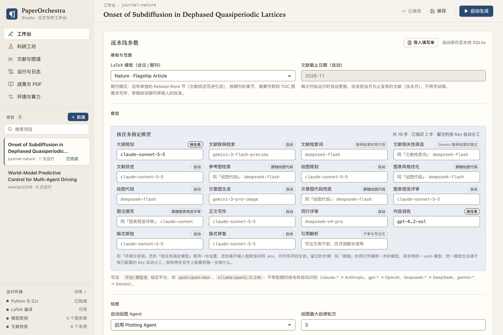
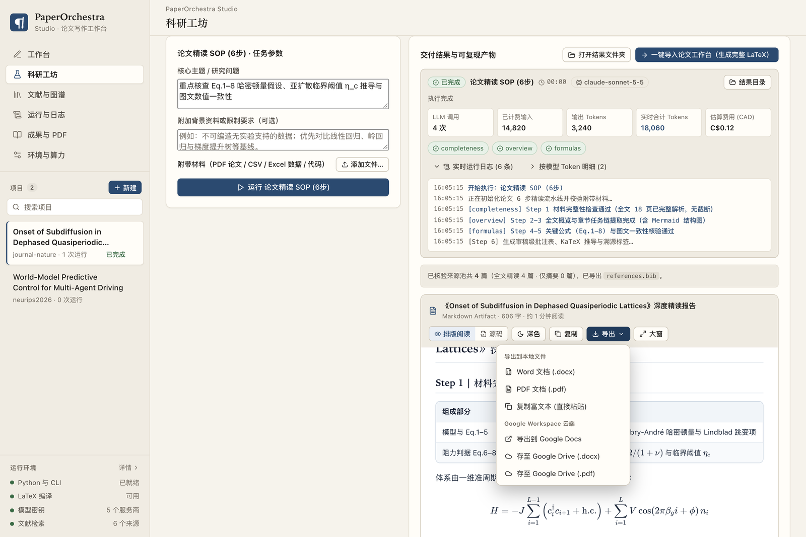
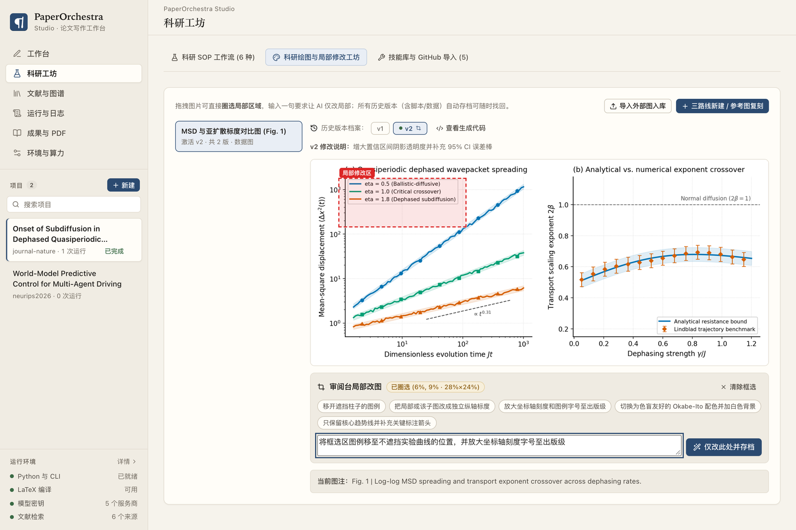
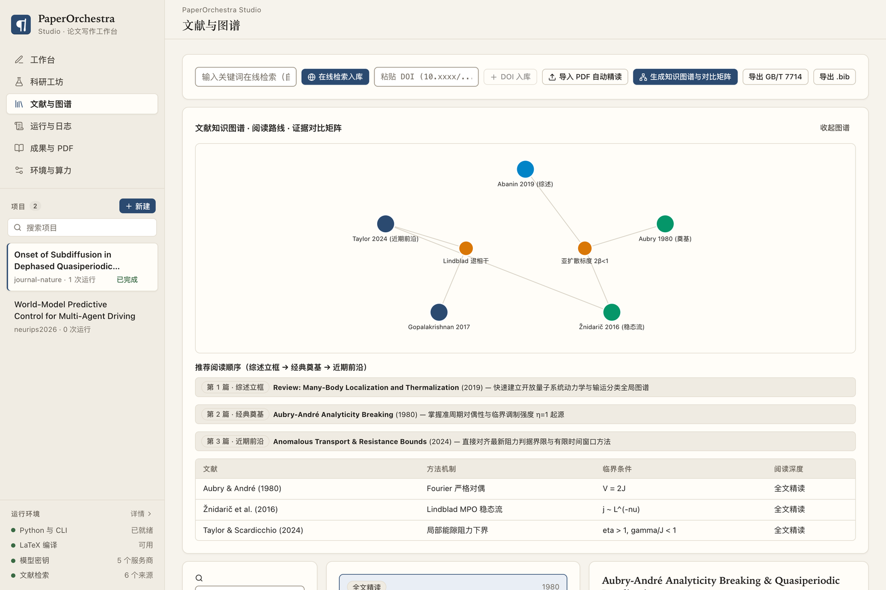
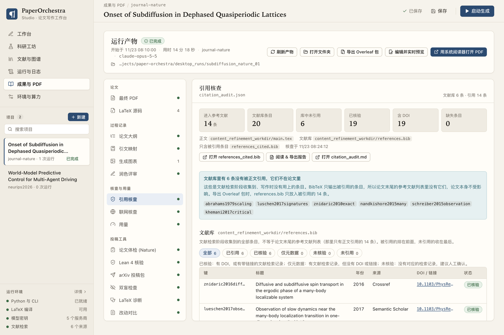
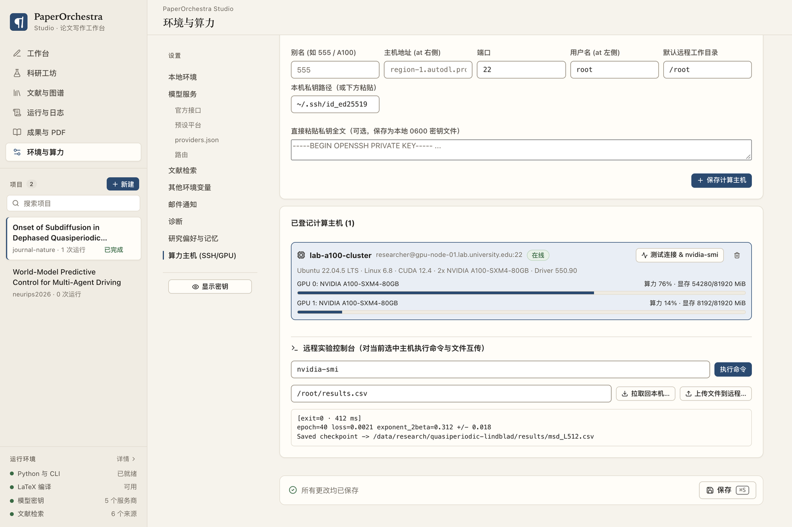

# PaperOrchestra Studio

**本地 AI 科研论文生成流水线与 LaTeX 桌面工作台** · *Local AI-Native Scientific Writing Pipeline & Tauri LaTeX Workbench*

基于 Google 开源的多智能体论文框架 [`google-research/paper-orchestra`](https://github.com/google-research/paper-orchestra) 深度扩展而来：保留原有零回退兼容性的同时，提供跨平台（macOS / Windows）桌面工作台、20+ 模型平台按步路由、8 源学术检索、双向 SyncTeX 实时编辑器、19 套会议/期刊 LaTeX 模板，以及离线投稿核查、科研工坊与类 Claude Artifacts 阅读导出工具。

**v1.2.0 起，同一套能力还以插件形式进入五个智能体平台**：Claude Code、Google Antigravity、OpenAI Codex、Qoder、WorkBuddy / CodeBuddy 装上后功能完全一致（24 个 `po_*` 工具、71 个桌面桥接工具、12 个工作流技能），另附 Coder (coder.com) 远程工作区的一键部署脚本。详见下方 [五平台智能体插件](#五平台智能体插件claude-code--antigravity--codex--qoder--workbuddy)。

---

## 下载安装

不想编译源码？直接到 **[Releases 页面](https://github.com/FelixJiashengFu/paper-orchestra-studio/releases/latest)** 下载：

| 系统 | 桌面应用 | Python 后端（必装） |
| --- | --- | --- |
| Windows 10/11 | `PaperOrchestra-Studio_<版本>_x64-setup.exe` | `PaperOrchestra-Backend-<版本>.zip` → 运行 `setup-backend.ps1` |
| macOS 11+（Intel / Apple 芯片） | `PaperOrchestra-Studio_<版本>_universal.dmg` | `PaperOrchestra-Backend-<版本>.zip` → 运行 `setup-backend.sh` |

> 桌面应用的版本号独立于仓库版本：v1.2.0 Release 里的桌面安装包仍是 `0.1.0`（应用本身自 v0.1.0 起没有改动，只是重新构建），后端包与插件包随 v1.2.0 更新。

只想在智能体里用？同一页面还提供五个平台的插件包 `paper-orchestra-studio-<版本>-<平台>.zip`（`claude-code` / `antigravity` / `codex` / `qoder` / `workbuddy`）和 Claude Desktop 一键扩展 `paper-orchestra-studio-<版本>.mcpb`，安装步骤见 [plugins/README.md](plugins/README.md)。

三步完成：**① 装 Python 3.11+ 与 TeX → ② 解压后端包运行安装脚本 → ③ 安装桌面应用并在「环境与算力」填入 API Key**。安装包暂未做代码签名，首次打开时的系统提示与完整图文步骤见 **[安装指南 docs/INSTALL.md](docs/INSTALL.md)**。

---

## 核心特性

* **20+ 模型平台与 19 步分任务路由**
  * 内置 OpenAI、Anthropic、Gemini、DeepSeek、通义千问、Kimi、智谱 GLM、腾讯混元、百度文心、硅基流动、OpenRouter、Ollama / LM Studio / vLLM 等平台，并支持 `providers.json` 自定义网关与中转站；
  * 支持工作台按步骤单独指定模型（大纲、文献筛选、绘图规划/风格/图像生成、正文写作、内容润色、模拟审稿等），自动记录 Token 用量与实时费用估算（`usage_report.json`），密钥仅保存于本机 `paper-orchestra/.env` 并在日志中自动打码。
* **8 源限速文献检索与双层引文核查**
  * 集成 Semantic Scholar、arXiv、OpenAlex、Crossref、dblp、Europe PMC、PubMed、CORE，共享限速器防 429；
  * 每次运行自动产出离线 `citation_audit.json / .md`，并可在桌面端一键联网对照 Crossref / arXiv / Semantic Scholar 核验 DOI、作者与年份（`cite-online`）。
* **19 套会议、期刊与数模/中文 LaTeX 模板**
  * **会议模板（8 套）**：`CVPR 2025`、`ICLR 2025`、`NeurIPS 2026`、`ICML 2026`、`AAAI 2027`、`ACL / ARR`、`IEEE Conference`、`ACM sigconf`；
  * **期刊与中文/数模模板（11 套）**：*Nature*、*Nature Methods*、*Nature Biotechnology*、*npj Computational Materials*、*ACS (JCTC / JPC / JCIM)*、*AIP J. Chem. Phys.*、*RSC PCCP*、*Elsevier Comput. Mater. Sci.*，以及 `journal-chinese-gb7714`（中文期刊 GB/T 7714）、`math-modeling-mcm`（美赛 MCM/ICM）、`math-modeling-cumcm`（国赛 CUMCM）；
  * 期刊模板由 `venue.json` 驱动写作风格（如无单独 Related Work、Claim-Driven 结构、去 AI 味与统计报告规范），会议模板提示词保持原版一字不变。
* **AI-Native LaTeX 工作台与投稿体检（SyncTeX）**
  * 内置 CodeMirror + pdf.js 的「编辑并实时预览」窗口，支持代码与 PDF 双向 SyncTeX 定位；
  * 集成 **论文体检 (Nature)**（剥离注释/浮动体的字数统计、AI 写作痕迹与破折号/分号节奏检查、图表引用与图注核对、草稿占位符扫描、统计要素与期刊声明核查）、**arXiv 投稿包**、**双盲检查**、**LaTeX 日志诊断**、**latexdiff 改动对比**与 **Overleaf 一键导出**。
* **科研工坊（6 大 SOP + 数据分析与绘图局部精修）**
  * 内置论文 6 步精读、防编造文献综述、从零到一科研选题、文献复现七步法、数学建模全流程、可逆清洗与自修复数据分析；
  * 支持实时阶段进度、流式日志、任务中止与实时 Token / 费用监控，并提供科研绘图与框选局部精修工作坊。
* **文献库与知识图谱 / 算力与记忆 / 技能库 / 形式化审计**
  * 支持本地文献库与引用关系图谱、项目长期记忆、远程 SSH/GPU 主机管理、GitHub 技能库导入，以及 Lean 4 形式化证明核查（`lean-audit`）。
* **类 Claude Artifacts 文档阅读与多格式导出**
  * 内置 Markdown / KaTeX 公式 / Mermaid 图表 / 目录跳转 / 全屏预览，支持一键导出 Word（`.docx`）、PDF、HTML 及本机 Google Drive / Google Docs（可通过 `PO_DEFAULT_PDF_DIR` / `PO_GOOGLE_DRIVE_DIR` 自定义默认导出目录）。

---

## 实际使用界面与实例说明

下面以一篇开放量子系统研究课题 **《Onset of Subdiffusion in Dephased Quasiperiodic Lattices》** 为完整演示实例，展示从项目配置、论文精读 SOP、科研绘图局部修改、文献知识图谱到投稿审计与远程 GPU 算力调度的端到端实际使用界面。

### 1. 论文工作台：项目配置与 19 步按任务模型路由

**实例场景**：在工作台新建课题并选中 `Nature · Flagship Article` 模板（自动启用期刊写作规范与当月截止日期 `2026-11`）。用户可以为大纲规划、文献检索、科研绘图、正文写作、内容润色、同行评审等 19 个节点按步骤混合路由 Claude、Gemini、GPT、DeepSeek 或本地 Ollama 模型；左下角实时监测 Python CLI、`pdflatex` 编译链、已配置平台与学术检索源状态，并可开启 **Plotting Agent** 进行至多 3 轮自动绘图自修。



### 2. 科研工坊：6 大 SOP 实时流式监控与类 Claude Artifacts 阅读导出

**实例场景**：针对附带的量子退相干论文 PDF 运行 **「论文精读 SOP (6步)」**。右上监控面板实时展示当前阶段状态胶囊（`completeness → overview → formulas`）、流式日志、LLM 调用次数、已计费输入 / 输出 Token（如 14,820 / 3,240 tokens）与估算费用（如 `C$0.12`），支持随时中止运行。下方 **类 Claude Artifacts 阅读器** 自动排版 GFM 检查表、KaTeX 哈密顿量公式与 Mermaid 流程图，并可一键导出 Word（`.docx`）、PDF、富文本或直接同步至 Google Drive / Google Docs。



### 3. 科研绘图审阅台：版本档案与鼠标框选局部精修

**实例场景**：在绘图工坊查看 `MSD 与亚扩散标度对比图 (Fig. 1)` 的历史版本（`v1 → v2`）时，发现左上角图例略靠近实验曲线。用户只需直接在画布上用鼠标拖拽圈选该局部区域（界面显示红色虚线框及坐标百分比 `6%, 9% · 28%×24%`），点击快捷提示或输入一句话修订指令，系统即可保持其余子图与数据曲线不变，仅局部重构脚本生成 `v3` 并自动存档同步到论文图表目录。



### 4. 文献库与知识图谱：多源入库、阅读顺序与对比矩阵

**实例场景**：通过关键词在线检索或 DOI / PDF 导入 5 篇相关文献后，点击「生成知识图谱与对比矩阵」。系统自动区分 **综述立框（蓝色）**、**经典奠基（绿色）**、**近期前沿（深蓝）** 与 **核心概念节点（橙色）** 并绘制引证演化连线，在下方生成推荐阅读路线（Abanin 2019 综述 → Aubry 1980 奠基 → Taylor 2024 前沿）及方法/临界条件对比表，并支持一键导出 GB/T 7714 或 `.bib`。



### 5. 成果与投稿工具箱：引文核查、论文体检与 SyncTeX 实时预览

**实例场景**：流水线运行完成后进入「成果与 PDF」视图，左侧完整收纳从 **最终 PDF / LaTeX 源码** 到 **引用核查 / 联网核查 / LLM 用量** 以及 **论文体检 (Nature) / Lean 4 核验 / arXiv 投稿包 / 双盲检查 / LaTeX 诊断 / latexdiff 改动对比** 的全部投稿工具。图中展示了 `citation_audit.json` 的离线核查总览：14 条进入参考文献、19 条含 DOI 并通过核验、0 条缺失键（`[?]`），且自动剔除未引用的 6 条备用文献，可直接点击顶部「编辑并实时预览」进入双向 SyncTeX 编辑器或导出 Overleaf `.zip`。



### 6. 环境与算力：远程 SSH / GPU 集群监控与长期科研记忆

**实例场景**：当论文涉及大规模数值模拟或深度学习训练时，可在「环境与算力 → 算力主机 (SSH/GPU)」登记课题组服务器或云端 GPU 实例（如 `lab-a100-cluster`）。点击「测试连接 & nvidia-smi」即可实时获取系统环境与多卡 A100 算力利用率及显存占用进度条，并可在下方远程实验控制台直接执行训练命令或一键双向传输 `.csv` / 权重文件；配合上方「研究偏好与长期记忆」，后续所有论文写作与 SOP 都会自动继承课题组的统计与绘图规范。



---

## 五平台智能体插件（Claude Code / Antigravity / Codex / Qoder / WorkBuddy）

同一套功能在五个平台上等价提供，全部由 `plugins/shared/` 一份源码生成：

* **零依赖 Python MCP 服务**（v1.2.0）：24 个模型可见工具 + 6 个资源（含 2 个 MCP Apps 交互界面：九标签工作台与工具树）+ 5 个提示词；
* **Studio 桌面桥接服务**（Node）：71 个工具，直接驱动正在运行的桌面应用；
* **12 个工作流技能** 与 1 个投稿审计子智能体（Codex 没有子智能体格式，以技能形式提供）。

| 平台 | 插件包位置 | 安装入口 |
| --- | --- | --- |
| **Claude Code**（及 Claude Desktop Cowork） | `plugins/claude-desktop/cowork-plugin/` | `claude plugin marketplace add FelixJiashengFu/paper-orchestra-studio` |
| **Google Antigravity** | `plugins/antigravity/` | `agy plugin install <路径>` |
| **OpenAI Codex** | `plugins/codex/` | `codex plugin marketplace add FelixJiashengFu/paper-orchestra-studio` |
| **Qoder** | `integrations/qoder-plugin/` | `qoder plugins install <路径>` 或在 Qoder Desktop 里装 zip |
| **WorkBuddy / CodeBuddy** | `plugins/workbuddy/` | 在插件页从仓库目录添加市场，或装 zip |
| Coder (coder.com) 工作区 | `plugins/coder/` | 工作区内运行 `install-in-workspace.sh`（Coder 没有自己的插件格式，工作区里跑的仍是 Claude Code / Codex 的同一份插件包） |

各平台的清单格式、MCP 注册方式与完整工具列表见 **[plugins/README.md](plugins/README.md)**。

### v1.2.0 新增

* **修回与投稿工具箱 `po_revision_toolkit`**（纯规则、不调用大模型）：审稿意见拆条成响应矩阵、投稿预检（页数/字数/摘要上限、占位符、未定义引用、双盲泄露、必备声明）、按 DOI 查 Crossref 撤稿与更正通告、CONSORT / PRISMA / STROBE / ARRIVE / ML 可复现性报告清单；
* **文献与稿件同步 `po_reference_sync`**：Zotero（本地 Zotero 7 API 或 Web API）检索、入库、合并 BibTeX、导出 RIS；Overleaf git 关联、拉取与推送（推送默认只演练，需 `confirm_push=true` 才真正执行，且只做快进、从不删除文件）；
* **5 个新技能**：`po-reviewer-response`（逐条回复信与 latexdiff 修订稿）、`po-venue-preflight`（选刊、防 desk reject 预检、压页、camera-ready、cover letter）、`po-claim-evidence-audit`（论断与证据台账、数字一致性、可复现性与数据/AI 使用声明）、`po-talk-poster`（论文转幻灯片、讲稿、问答演练、海报）、`po-submission-auditor`（端到端投稿审计）；
* **Claude Code 侧边栏面板 `/po-pane`**（`plugins/claude-code-pane/`，v0.2.1）：在对话旁常驻显示 Studio 连接状态、项目、运行（费用 / Token / 引文核查）、后台任务与文献库；「打开 PDF / 在文件夹中显示」支持 macOS、Windows、Linux 与 WSL。侧边栏面板是 Claude Code 独有的扩展点，其余平台通过同样的工具和 MCP Apps 工作台获得同样的信息；
* **Windows 兼容**：MCP 服务强制 UTF-8 标准输入输出，不再受系统代码页影响。

### 校验与打包

```bash
python3 plugins/scripts/verify_platforms.py --strict   # 44 项检查：清单、文件、技能、子智能体、市场文件，并按各宿主的方式真实启动两个 MCP 服务比对握手结果
python3 -m unittest discover -s plugins/tests -v       # 同样的检查加上新工具的单元测试；CI 在 Ubuntu / macOS / Windows 上各跑一遍
python3 plugins/scripts/install.py --platform all      # 生成各平台 zip 到 plugins/dist/ 并打印安装步骤
```

### 已验证与尚未验证

说清楚边界，免得「五平台等价」听起来比实际证据更响亮：

| 已由自动化检查覆盖 | 尚未在真实环境验证 |
| --- | --- |
| 五个插件包的清单、文件、技能与工具列表逐一比对一致 | 各宿主应用（Antigravity、Codex、Qoder、WorkBuddy 等）实际加载插件包的表现：校验脚本只模拟宿主启动 MCP 服务，不能证明应用界面里一定能装上 |
| 每个包里的两个 MCP 服务都能启动并完成握手 | `po_reference_sync` 连接真实 Zotero 账号与真实 Overleaf 项目：目前只有针对模拟服务的单元测试 |
| `po_revision_toolkit`、`po_reference_sync` 的离线单元测试 | `plugins/coder/paper-orchestra.tf` 在真实 Coder 部署上的 `terraform apply`：按模块文档编写，脚本语法已检查 |
| Ubuntu / macOS / Windows 三系统 CI | |

装好后的冒烟测试：让智能体调用一次 `po_check_environment`。遇到装不上的情况，欢迎带上平台与版本号提 issue。

---

## 仓库结构

```text
paper-orchestra-studio/
├── paper-orchestra/            # Python 多智能体论文流水线、模板库、核查/投稿工具与单元测试
├── paper-orchestra-desktop/    # Tauri (Rust + React/TypeScript) 桌面端应用与打包脚本
├── plugins/                    # 五平台原生插件包（claude-desktop/、antigravity/、codex/、workbuddy/ 与 shared/ 共享 MCP/UI/技能）、
│                               #   Claude Code 侧边栏面板（claude-code-pane/）、Coder 工作区部署脚本（coder/）及同步、校验、打包脚本
├── integrations/               # Qoder 插件（integrations/qoder-plugin/）、实时论文工作台、工具树与 Canvas 控制台
├── scripts/                    # 后端一键安装脚本（setup-backend.ps1 / .sh）
├── docs/                       # 安装指南（INSTALL.md）、各版本发布说明（releases/）与界面截图（screenshots/）
├── LICENSE                     # Apache License 2.0
└── THIRD_PARTY_NOTICES.md      # 上游与第三方开源归属声明（Google / Lattice / Nature-Paper-Skills / TeX 样式）
```

---

## 从源码运行（开发者）

### 1. 准备 Python 后端环境（Python 3.11+）

```bash
cd paper-orchestra
python3 -m venv .venv
.venv/bin/python -m pip install --prefer-binary -r requirements.txt
cp .env.example .env
```

* 建议同时安装 TeX 发行版（macOS 推荐 MacTeX / BasicTeX，Windows 推荐 TeX Live 或 MiKTeX）以本地编译 PDF。
* 命令行用法与环境变量参考：[paper-orchestra/README.md](paper-orchestra/README.md) · [paper-orchestra/docs/PROVIDERS_zh.md](paper-orchestra/docs/PROVIDERS_zh.md)。

### 2. 运行或打包桌面应用（Node 20+ / Rust）

```bash
cd paper-orchestra-desktop
npm install
npm run tauri dev          # 开发模式运行
```

生成安装包：
* **macOS**：`./scripts/build-macos.sh`（可选 `universal` 或 `PO_MAC_DMG=1`）
* **Windows**：`powershell -ExecutionPolicy Bypass -File .\scripts\build-windows.ps1`

完整图文使用与配置说明见：[paper-orchestra-desktop/README.md](paper-orchestra-desktop/README.md) 与 [paper-orchestra/CHANGELOG_zh.md](paper-orchestra/CHANGELOG_zh.md)。

---

## 测试

```bash
# Python 单元测试（全部离线运行，无需真实 API Key）
paper-orchestra/.venv/bin/python -m unittest discover -s paper-orchestra/tests -v

# 五平台插件一致性测试
python3 -m unittest discover -s plugins/tests -v

# 前端类型检查与 Rust 单元测试
cd paper-orchestra-desktop
npx tsc --noEmit
cargo test --manifest-path src-tauri/Cargo.toml
```

---

## 开源许可与致谢

本项目采用 **Apache License 2.0** 发布，详情见 [LICENSE](LICENSE) 与 [THIRD_PARTY_NOTICES.md](THIRD_PARTY_NOTICES.md)。
感谢 [`google-research/paper-orchestra`](https://github.com/google-research/paper-orchestra)、[`leo1oel/lattice`](https://github.com/leo1oel/lattice) 以及 [`Boom5426/Nature-Paper-Skills`](https://github.com/Boom5426/Nature-Paper-Skills) 的开源贡献。
